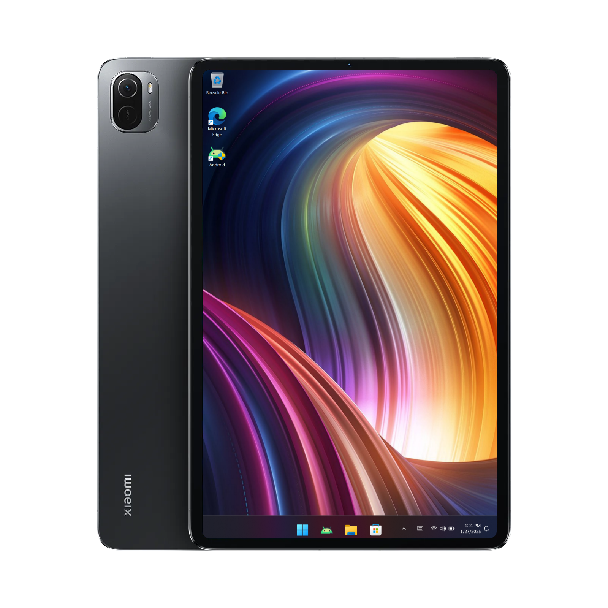

# Xiaomi Pad 5 Backup and restore Windows [Without PC]

- 
#

## Prerequisites
- Must be rooted with Magisk/KernelSU installed
- [`Modified TWRP recovery`](https://github.com/Kumar-Jy/Windows-in-NABU-Without-PC/releases/tag/Modded-TWRP-Recovery)
  
  
## Backup Windows
- If you are in windows, must return to Android either through Android shortcut from desktop or by flashing stock boot.img through fastboot `fastboot flash boot_ab /path/to/boot.img`
  
- Boot to the Modded TWRP, Goto`Advance` **>** `Terminal` and type command `backupwin` - press enter or type the custom path if you want to backup in any other usb stick.
  
- Wait until backup done.

---
 ## Restore Windows
 
- Make sure you already have win and esp partition.
 
- Download [`NABU_fix_BCD_boot.zip`](https://github.com/Kumar-Jy/Windows-in-NABU-Without-PC/releases/download/Files/NABU_BCD_boot_fix.zip)
 
- Reboot to Modded-TWRP-Recovery goto`Advance` **>** `Terminal` and type command `restorewin` - press enter or type the custom path if you have copied the winbackup.wim at any other location.

- Flash/Sideload `NABU_fix_BCD_boot.zip`

- Reboot if flashing done.

---
## Setup Dual-Boot

- Download the [UEFI.img](https://github.com/remtrik-stuff/MiPad5-Windows-Releases/releases) and copy it inside the folder named `UEFI` in your internal storage.
  
- Install [WOA-Helper.apk](https://github.com/n00b69/woa-helper/releases/tag/APK) , open it and grant root permission.
  
- Go to ***BACKUP BOOT IMAGE***.
  
- Select ***WINDOWS*** as the target.
  
- Now, press the ***QUICKBOOT TO WINDOWS*** button.
